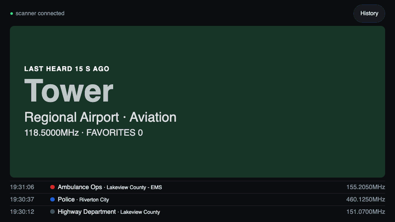
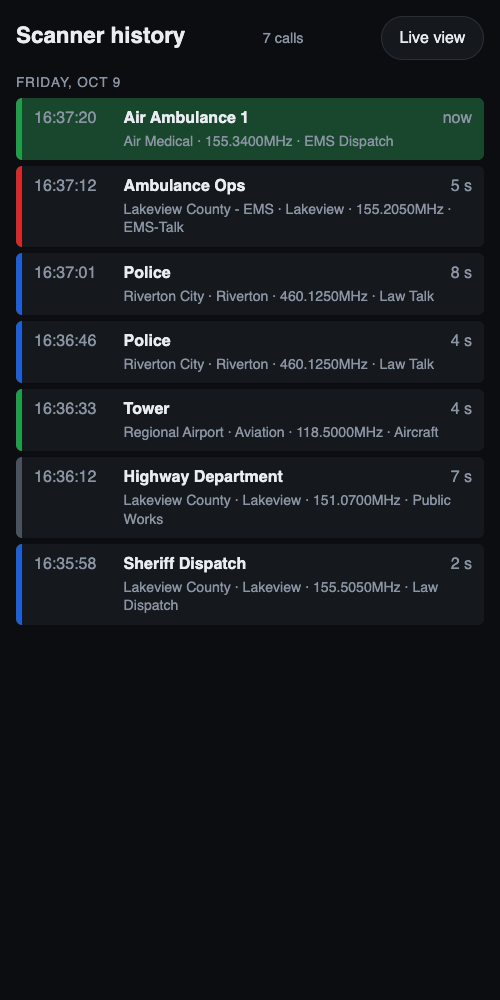

# uniden-scanner-display

A live, color-coded display of what a Uniden BCD536HP scanner is receiving, served as a web page. Plug the scanner into a Raspberry Pi with a USB cable, then open the page on anything with a browser: a phone, an old iPad on the end table, a laptop, or a touchscreen on the Pi itself.



It started because the scanner's own backlight died, but it turned out better than the built-in screen even when that works: big text you can read across the room, colors you can tell apart at a glance, and a history of what you missed.

- **Live view** (`/`): the channel it's on now, in large type, with the department, system, frequency and favorites list. Signal strength while receiving; "last heard 3 min ago" once it's quiet. The last few calls are listed underneath.
- **Colors by service type**: blue for law, red for fire / EMS / hospital, green for aircraft and air medical, gray for everything else. Full color while a call is coming in, a faint wash once it ends.
- **Encrypted calls** are marked "encrypted · no audio", so you know why the scanner stopped and you hear nothing.
- **History** (`/history`): the last 200 calls, grouped by day, with time, duration and service type.
- **Keeps retrying** if the scanner is off, unplugged, or still starting up, and the page warns you when it loses the scanner or the server.



No apps, no Windows, no extra Python packages: it's plain Python 3 (standard library only) and one HTML page.

## What you need

- **A Uniden BCD536HP.** Tested on firmware 1.23.00. The BCD436HP uses the same remote commands and should work, but hasn't been tested. Newer SDS models are untested.
- **A computer to plug it into.** A Raspberry Pi is ideal (any model with a USB-A port: a Pi 3 is plenty), but any Linux machine or Mac works.
- **A USB cable for the mini-USB port on the scanner's front panel.** The BCD536HP has two USB ports, and only the **front mini-USB** port talks to a computer. The full-size USB-A port is only for Uniden's Wi-Fi adapter. You need mini-USB on the scanner end, and whatever your Pi or computer takes on the other end (USB-A for a Pi 3 or 4). Push the plug in firmly: a half-seated mini-USB plug often isn't detected.
- **Or, untested: the rear GPS/Remote port.** Other users report that the remote commands also work on the 9-pin serial port on the back, which would leave the front port free. It needs Uniden's serial cable (from the BC-SGPS GPS kit) and a USB-to-DB9 **null-modem** adapter, with the scanner's GPS baud rate set to 115200 in its menu. A USB serial adapter shows up as `/dev/ttyUSB0` on Linux, which isn't found on its own, so set `SCANNER_PORT=/dev/ttyUSB0`. If you try it, please open an issue saying whether it worked.
- **For a Pi:** a 5V power supply rated 2.5 A or more (3 A if you add a screen) and a microSD card.

## Try it first, no scanner needed

On any computer with Python 3:

```sh
git clone https://github.com/dfspaul/uniden-scanner-display.git
cd uniden-scanner-display
./display.py --demo
```

Open http://localhost:8000/ to watch made-up calls come in.

## Check that the scanner talks

Plug the scanner's front mini-USB port into the computer and turn the scanner on. With a USB cable attached at startup, the scanner asks **Select USB Mode**: Mass Storage (for reading its SD card) or Serial Port. **Leave it alone and wait about 15 seconds**: on firmware 1.10.02 and later it picks Serial Port on its own, which is the mode this needs. Don't choose Mass Storage. The display server just keeps retrying until the serial port appears, so it's fine to start it before the scanner is ready. Then:

```sh
./uniden.py MDL VER       # BCD536HP, then the firmware version
./uniden.py status        # what it's on right now
./uniden.py watch         # a line per call; Ctrl-C to stop
```

If the scanner ends up in Mass Storage mode anyway, it shows up as a USB drive instead of a serial port, and nothing here can talk to it. Unplug the USB cable and plug it back in (or power the scanner off and on), and wait out the prompt again.

The scanner shows up as `/dev/ttyACM0` on Linux and `/dev/cu.usbmodem…` on a Mac, with no driver to install. If more than one such port is present, set `SCANNER_PORT=/dev/ttyACM0` (or whichever it is). On Linux other than Raspberry Pi OS, if you get "permission denied", add yourself to the `dialout` group (`sudo usermod -aG dialout $USER`) and log in again.

## Set it up on a Raspberry Pi

1. With [Raspberry Pi Imager](https://www.raspberrypi.com/software/), write **Raspberry Pi OS Lite (64-bit)** to the card (it's under "Raspberry Pi OS (other)"). In the settings, set a hostname (for example `scanner-pi`), your user name, Wi-Fi, and turn on SSH.
2. Boot the Pi, plug in the scanner, and log in: `ssh <you>@scanner-pi.local`.
3. Install it:
   ```sh
   sudo apt install -y git
   git clone https://github.com/dfspaul/uniden-scanner-display.git
   cd uniden-scanner-display
   ./uniden.py status       # check the scanner answers
   ./install.sh
   ```
   `install.sh` sets up a systemd service (`scanner-display`) that runs as your user from this folder, starts at boot, and restarts if it stops. It serves on port 80 without running as root.
4. Open **http://scanner-pi.local/** on your phone, tablet or laptop.

Phones and iPads handle `.local` names fine. Some Android devices don't: if the name doesn't work, use the Pi's IP address instead, and reserve that address in your router so it stays the same.

To update later: `git pull`, then `sudo systemctl restart scanner-display`.

### An old iPad or phone as the screen

Open the page in Safari, then use **Share → Add to Home Screen** so it opens full screen. To keep it on the page and awake, turn on **Guided Access** (Settings → Accessibility) and set **Auto-Lock** to Never while it's plugged in.

### A touchscreen on the Pi

Coming once it has been tested. The page is already sized for a 7" touchscreen (the History and Live view buttons are large enough to tap); what's left is starting a full-screen browser on the Pi at boot.

## Colors

The color comes from each channel's service type, which the scanner reports for every call (from the Uniden / RadioReference database):

| Color | Service types |
|---|---|
| Blue | Law (dispatch, talk, tac), Corrections |
| Red | Fire, EMS, Hospital |
| Green | Aircraft, plus any list, system or department named in `SCANNER_FLIGHT` |
| Gray | Everything else |

Air medical channels are usually tagged as EMS, so they'd show red. To show a favorites list (or a system or department) green instead, name it in `SCANNER_FLIGHT`. It defaults to `Air Medical`. To change it, run `sudo systemctl edit scanner-display`, add:

```ini
[Service]
Environment=SCANNER_FLIGHT=Air Medical,Med Flight
```

then `sudo systemctl restart scanner-display`. That setting survives `git pull` and re-running `install.sh`.

The rules are in `kind()` in `display.py`, if you want different ones.

## uniden.py

`display.py` uses `uniden.py` to talk to the scanner, and you can use it on its own too:

```
./uniden.py MDL VER ...        send raw remote commands, print each reply
./uniden.py status             what it's on now: list / system / department / channel
./uniden.py watch [seconds]    print a line each time it stops on a channel with signal
./uniden.py qk                 favorites list quick keys and whether each is on
./uniden.py qk 2 on|off        turn a favorites list quick key on or off
```

Only one program can use the scanner's port at a time. While the service is running, stop it first (`sudo systemctl stop scanner-display`), or the two will garble each other's replies. If `qk` says the scanner is in a menu, back out of the menu on the scanner and try again.

## How it works

`display.py` sends the scanner's `GSI` remote command twice a second over USB serial. The reply is a small XML document with what the front panel would show: favorites list, system, department, channel or talkgroup, frequency, service type, signal and P25 status. Each stop with signal goes in the log. On a trunked system's control channel there's signal but no talkgroup, so that doesn't count as a call. The page polls `/state.json` and draws it. The history is kept in memory only, so restarting the service clears it.

## Security

The page has no login and shows what your scanner is receiving. Keep it on your home network: don't forward a port to it from the internet.

## License

MIT, see [LICENSE](LICENSE).

Not affiliated with or endorsed by Uniden. Uniden and BCD536HP are trademarks of their owner.
